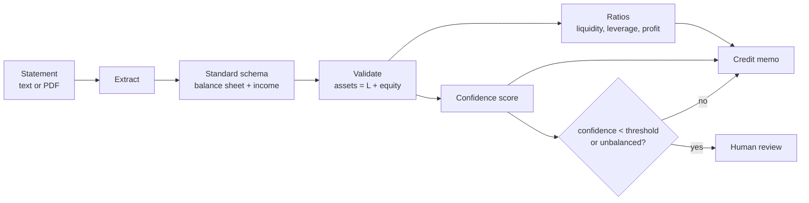

# SpreadAI

**Document AI for financial statements: read them, check them, and draft a credit memo.**

SpreadAI takes a company's financial statement (as text or a PDF), "spreads" it into one
standard shape, checks the accounting, computes the key ratios, and writes a short credit
memo. When it is not sure the numbers are right, it sends the case to a human instead of
guessing.

> SpreadAI has two data paths. The demo and the unit tests use statements the project
> **generates itself** (deterministic and internally consistent — ideal for testing the
> extractor and the validator against known-good inputs). The **headline validation runs
> on real data**: the American Bankruptcy panel of U.S. public companies (1999–2018),
> spread through the same pipeline and scored against the dataset's own failure labels.
> See [Real-data validation](#real-data-validation).

[](.github/workflows/ci.yml)
[](pyproject.toml)
[](LICENSE)

---

## Why it exists

To decide on a loan, an analyst first has to "spread" the borrower's financial statement:
copy every line into a standard template, check that it adds up, and compute ratios. This
is slow and easy to get wrong. SpreadAI does the first pass automatically, but with two
rules that keep it safe:

1. **It checks the accounting.** Assets must equal liabilities plus equity. If they do
   not, the extraction is probably wrong, so confidence drops.
2. **It knows when to stop.** When confidence is low, the case is flagged for human
   review. The tool helps the analyst; it does not replace their judgement.

## How it works



* **Extract.** A deterministic text parser reads clean statements (it maps labels like
  "Sales" or "COGS" to standard keys). PDFs are read with pdfplumber. A messy statement
  can fall back to an LLM extractor.
* **Validate.** The main check is the accounting identity. Confidence combines how many
  line items were found with whether the statement balances.
* **Ratios.** Liquidity (current, quick), leverage (debt-to-equity, interest coverage),
  and profitability (margins, ROA, ROE).
* **Memo.** A template memo built from the numbers, or an LLM-written memo.

## Quickstart

```bash
python -m venv .venv && source .venv/bin/activate
make install
make demo          # generate a statement, spread it, print ratios + memo
make test          # full test suite
make run           # serve the API on http://localhost:8000 (docs at /docs)
```

### The API

| Method | Path | What it does |
|---|---|---|
| `GET` | `/health` | Liveness check |
| `POST` | `/spread/text` | Spread a statement given as text |
| `POST` | `/spread/pdf` | Spread a statement given as a PDF upload |

```bash
# Generate a sample PDF, then spread it
make sample
curl -s -F "file=@out/sample_statement.pdf" http://localhost:8000/spread/pdf
```

## Provider-agnostic LLM

The LLM parts (the extractor fallback and the written memo) do not depend on one vendor.
They use a **provider cascade** (`spreadai/llm/`): it tries providers in order — Anthropic,
OpenAI, Gemini, DeepSeek, or a local Ollama model — and falls back to the next one if one
fails. Set the order with `SA_LLM_PROVIDERS`; each provider reads its own API key from the
environment. The default memo mode is `template`, which needs no LLM at all.

## OCR for scanned PDFs (optional)

A normal (text) PDF is read directly. A scanned PDF is an image, so it needs OCR. OCR is
optional: install the extra and the system `tesseract` binary.

```bash
pip install 'spreadai[ocr]'   # plus: apt-get install tesseract-ocr poppler-utils
```

If OCR is not available and a PDF has no text, the API returns a clear error instead of
empty results.

## Project layout

```
spreadai/
  schema.py        the standard shape of a spread statement
  labels.py        line-item labels and aliases for parsing
  generate.py      synthetic statements + PDF rendering
  extract/         text parser, PDF reader (+ optional OCR), LLM extractor
  validate.py      accounting checks and the confidence score
  ratios.py        credit ratios
  memo.py          template memo and LLM memo
  service.py       the flow: extract -> validate -> ratios -> memo -> review flag
  llm/             provider-agnostic LLM cascade
  main.py          FastAPI endpoints
  cli.py           the demo command
  real_data.py     load + spread the real American Bankruptcy panel
  real_benchmark.py generalization benchmark (baseline, CV, held-out, controls)
datasets/          vendored snapshot of the real dataset (+ its README)
```

## Real-data validation

The demo runs on generated statements, but the capability is validated on **real financial
statements**. The [American Bankruptcy dataset](datasets/README.md) (Lombardo et al.,
*Future Internet* 2022) is a panel of U.S. public companies from Compustat, 1999–2018, with
three fiscal years of line items per company and a forward-looking label (`failed` = filed
for bankruptcy the next year). Each company is spread through **SpreadAI's own pipeline** —
`parse_text` → `validate` → `compute_ratios` — and the resulting ratios feed one downstream
question a credit desk cares about: *does this company fail next year?*

```bash
make benchmark        # spreads the real panel and prints the report below
```

| Metric | Value |
|---|---|
| Train / held-out records | 3,142 / 2,815 (held-out = fiscal years 2016–2018) |
| Extraction field coverage | 0.722 (the source carries 13 of the 18 canonical lines) |
| Accounting identity balanced | 100% of reconstructed statements |
| **Baseline** (majority) ROC-AUC | **0.500** |
| Stratified 5-fold CV ROC-AUC | **0.707 ± 0.022** |
| Train ROC-AUC | 0.739 |
| **Held-out ROC-AUC (2016–2018)** | **0.712** |
| Held-out average precision | 0.066 (vs. 0.026 prevalence) |
| Negative control — shuffled labels (CV) | 0.491 |
| Negative control — scrambled inputs (held-out) | 0.533 |
| **Verdict** | **well-fit** |

The verdict is derived, not asserted: cross-validation (0.707) and the held-out years
(0.712) **agree** and both clear the 0.500 baseline, while the train gap is narrow (+0.027).
Both negative controls collapse to chance — shuffling the labels or scrambling the feature
columns destroys the signal — which rules out leakage. The model is a regularized logistic
regression, so it *cannot* memorize; a large train/held-out gap would be a real warning
rather than a capacity artefact. See the Spanish walkthrough in
[`docs/estudio/04-validacion-datos-reales.md`](docs/estudio/04-validacion-datos-reales.md)
for the metrics, formulas, and a worked example on a real company.

## Testing and quality

* **34 tests** cover extraction, validation, ratios, the LLM parts (with fakes, no
  network), the service, the API, and the real-data path — the loader's shape and labels,
  the spread of a real failed company, the held-out benchmark beating the baseline, the
  verdict discriminating a real fit from a shuffled one, and the dataset fetch retrying
  offline (retry-then-succeed and retry-exhausted). CI requires at least 80% coverage.
* `ruff` for lint, `bandit` and `gitleaks` for security.

See [`docs/architecture.md`](docs/architecture.md), the [ADRs](docs/adr/), and the Spanish
study guide in [`docs/estudio/`](docs/estudio/).

## Limitations and how to extend

The deterministic parser expects "Label: amount" lines; a very different layout routes to
the LLM extractor. Confidence is a heuristic by design — its job is to route doubtful spreads
to a human, not to be a calibrated probability. On the real-data path, the source reports no
interest-expense line, so interest coverage is left undefined and the income statement is
mapped to SpreadAI's schema with equity as the balancing item (documented in
[`datasets/README.md`](datasets/README.md)).

Natural next steps, each building on code that already exists:

* **Learn the confidence score.** Replace the heuristic in `validate.py` with a model
  calibrated against the human-review outcomes the service already records.
* **Richer features.** The benchmark uses nine ratios over three years; add working-capital
  and cash-flow lines, or per-industry normalization using the dataset's SIC groups.
* **Line-item traceability.** Record, for each extracted number, the source line it came
  from, so a reviewer can audit the spread.
* **Full filings.** The dataset ships the matching 10-K text items; wire the LLM extractor
  to spread from the narrative and compare it against the structured spread.

## License

[MIT](LICENSE) © Angelo David Padilla Romero
