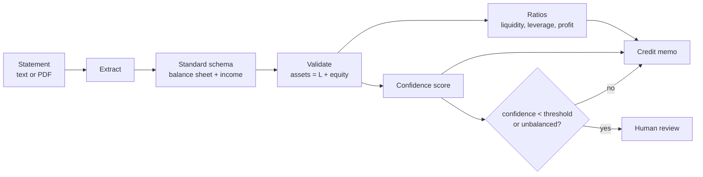

# SpreadAI

**Document AI for financial statements: read them, check them, and draft a credit memo.**

SpreadAI takes a company's financial statement (as text or a PDF), "spreads" it into one
standard shape, checks the accounting, computes the key ratios, and writes a short credit
memo. When it is not sure the numbers are right, it sends the case to a human instead of
guessing.

> All data is **synthetic**. The sample statements are generated by the project itself.
> No real company is involved.

[](.github/workflows/ci.yml)
[](pyproject.toml)
[](LICENSE)

---

## Why it exists

To decide on a loan, an analyst first has to "spread" the borrower's financial statement:
copy every line into a standard template, check that it adds up, and compute ratios. This
is slow and easy to get wrong. SpreadAI does the first pass automatically, but with two
rules that keep it safe:

1. **It checks the accounting.** Assets must equal liabilities plus equity. If they do
   not, the extraction is probably wrong, so confidence drops.
2. **It knows when to stop.** When confidence is low, the case is flagged for human
   review. The tool helps the analyst; it does not replace their judgement.

## How it works



* **Extract.** A deterministic text parser reads clean statements (it maps labels like
  "Sales" or "COGS" to standard keys). PDFs are read with pdfplumber. A messy statement
  can fall back to an LLM extractor.
* **Validate.** The main check is the accounting identity. Confidence combines how many
  line items were found with whether the statement balances.
* **Ratios.** Liquidity (current, quick), leverage (debt-to-equity, interest coverage),
  and profitability (margins, ROA, ROE).
* **Memo.** A template memo built from the numbers, or an LLM-written memo.

## Quickstart

```bash
python -m venv .venv && source .venv/bin/activate
make install
make demo          # generate a statement, spread it, print ratios + memo
make test          # full test suite
make run           # serve the API on http://localhost:8000 (docs at /docs)
```

### The API

| Method | Path | What it does |
|---|---|---|
| `GET` | `/health` | Liveness check |
| `POST` | `/spread/text` | Spread a statement given as text |
| `POST` | `/spread/pdf` | Spread a statement given as a PDF upload |

```bash
# Generate a sample PDF, then spread it
make sample
curl -s -F "file=@out/sample_statement.pdf" http://localhost:8000/spread/pdf
```

## Provider-agnostic LLM

The LLM parts (the extractor fallback and the written memo) do not depend on one vendor.
They use a **provider cascade** (`spreadai/llm/`): it tries providers in order — Anthropic,
OpenAI, Gemini, DeepSeek, or a local Ollama model — and falls back to the next one if one
fails. Set the order with `SA_LLM_PROVIDERS`; each provider reads its own API key from the
environment. The default memo mode is `template`, which needs no LLM at all.

## OCR for scanned PDFs (optional)

A normal (text) PDF is read directly. A scanned PDF is an image, so it needs OCR. OCR is
optional: install the extra and the system `tesseract` binary.

```bash
pip install 'spreadai[ocr]'   # plus: apt-get install tesseract-ocr poppler-utils
```

If OCR is not available and a PDF has no text, the API returns a clear error instead of
empty results.

## Project layout

```
spreadai/
  schema.py        the standard shape of a spread statement
  labels.py        line-item labels and aliases for parsing
  generate.py      synthetic statements + PDF rendering
  extract/         text parser, PDF reader (+ optional OCR), LLM extractor
  validate.py      accounting checks and the confidence score
  ratios.py        credit ratios
  memo.py          template memo and LLM memo
  service.py       the flow: extract -> validate -> ratios -> memo -> review flag
  llm/             provider-agnostic LLM cascade
  main.py          FastAPI endpoints
  cli.py           the demo command
```

## Testing and quality

* **24 tests** cover extraction, validation, ratios, the LLM parts (with fakes, no
  network), the service, and the API. CI requires at least 80% coverage.
* `ruff` for lint, `bandit` and `gitleaks` for security.

See [`docs/architecture.md`](docs/architecture.md), the [ADRs](docs/adr/), and the Spanish
study guide in [`docs/estudio/`](docs/estudio/).

## Honest limits

The deterministic parser expects "Label: amount" lines; very different layouts need the
LLM extractor. Confidence is a heuristic, not a guarantee — it is there to route doubtful
cases to a human, which is the point. SpreadAI does the first pass; a credit officer still
makes the decision.

## License

[MIT](LICENSE) © Angelo David Padilla Romero
