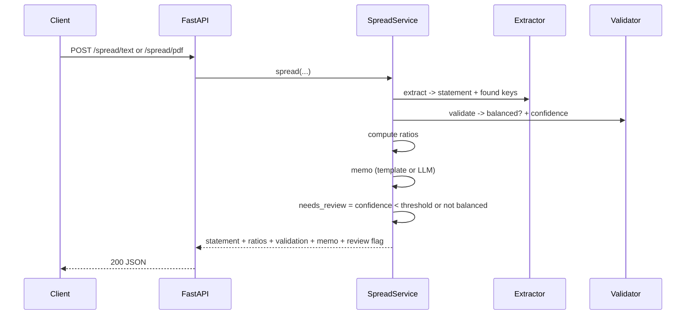

# Architecture

## Goal

Turn a financial statement (text or PDF) into a standard, checked set of numbers, with a
credit memo, and send doubtful cases to a human.

## Components

| Layer | Module | What it does |
|---|---|---|
| Schema | `schema.py` | The standard shape: balance sheet + income statement, with totals |
| Labels | `labels.py` | Line-item labels and aliases, so parsing is robust |
| Generate | `generate.py` | Synthetic statements and PDF rendering (for tests and demos) |
| Extract | `extract/` | Text parser, PDF reader (+ optional OCR), LLM extractor |
| Validate | `validate.py` | Accounting checks and the confidence score |
| Ratios | `ratios.py` | Liquidity, leverage, and profitability ratios |
| Memo | `memo.py` | Template memo or LLM-written memo |
| Flow | `service.py` | Ties the steps together |
| LLM | `llm/` | Provider-agnostic cascade with fallback |
| API | `main.py` | FastAPI endpoints |

## The flow

## Extraction

Two paths, same `ExtractionResult`:

* **Text parser** (`extract/text_parser.py`) reads "Label: amount" lines, maps the label
  to a canonical key with `labels.py` (primary label or alias), and parses the amount
  (commas, parentheses for negatives, currency signs). It is deterministic and fast.
* **PDF reader** (`extract/pdf.py`) gets the text with pdfplumber. If the PDF is scanned
  (no text), it uses OCR — but only if the optional extra and the tesseract binary are
  present; otherwise it raises a clear error.
* **LLM extractor** (`extract/llm_extractor.py`) is the fallback for messy statements. It
  asks the provider cascade to return the canonical keys as JSON.

Each result reports **field coverage**: how many of the standard line items were found.

## Validation and confidence

The main check is the accounting identity: assets must equal liabilities plus equity,
within a small tolerance. Confidence starts from field coverage and drops when the
statement does not balance, has no revenue, or has negative core items. A case goes to a
human when confidence is below the threshold or the statement does not balance. This is
the safety rule: the tool never hides a doubtful extraction.

## Provider-agnostic LLM

`llm/` is a small layer: one `LLMClient` interface, HTTP adapters for several providers,
and a `CascadeLLM` that tries them in order and falls back on failure. The extractor and
the memo depend on the interface, not on a vendor. In tests, a fake client is injected, so
nothing hits a real API.

## Configuration

Settings use the `SA_` prefix (see `.env.example`): the review threshold, the balance
tolerance, the memo mode (`template` or `llm`), and the provider order.
